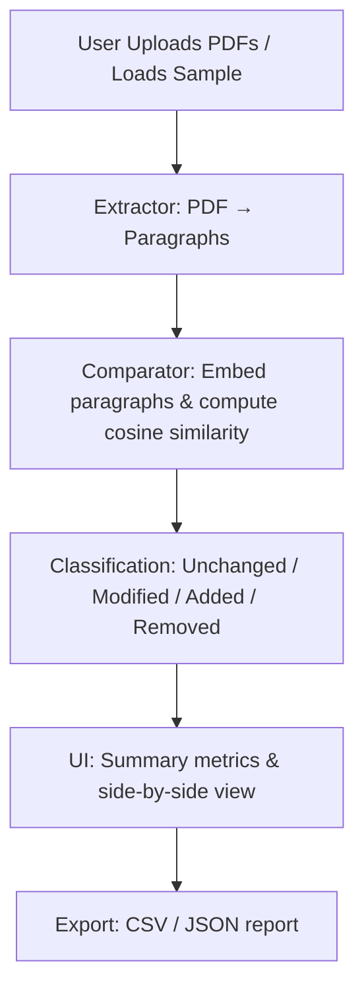

# docdiff-auditor

## Problem Statement

Enterprises often need to audit changes between two versions of legal or policy documents (e.g., contracts, terms of service). Simple textual diffs highlight literal word changes but miss semantic shifts such as re‑phrasing, clause relocation, or subtle additions/removals. **docdiff-auditor** is a minimal‑boilerplate Streamlit app that compares two PDF documents, extracts meaningful textual chunks, embeds them with a state‑of‑the‑art sentence transformer, and highlights semantic changes.

## Architecture



## Quick Start (3 commands)

```bash
# 1. Install dependencies
pip install -r requirements.txt

# 2. Run the Streamlit app
streamlit run app.py
```

The app will launch in your browser. You can either upload two PDF files or click the **Load Sample Contract Diff** button to see a demo with two built‑in sample contracts.
