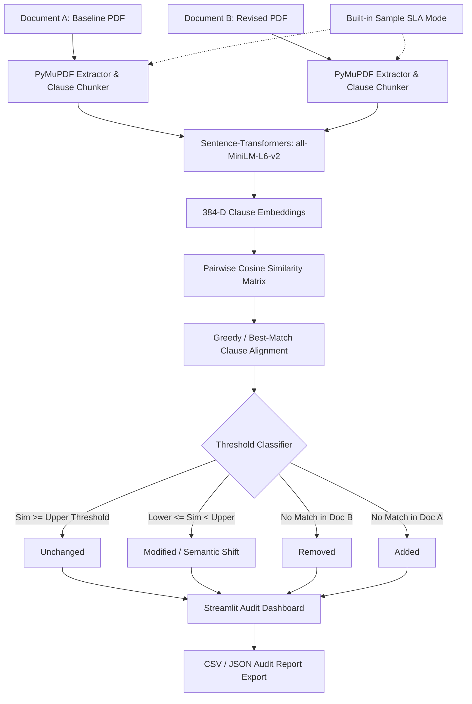

# 📄 DocDiff Auditor — Semantic Document Comparison Engine


**DocDiff Auditor** is a lightweight, CPU-friendly semantic PDF auditing tool built to detect meaningful policy, contract, and specification changes across document revisions. Unlike traditional line-by-line diff utilities that break on reformatting, reordered clauses, or minor phrasing edits, DocDiff Auditor embeds document clauses into dense vector space and aligns them using cosine similarity.

---

## 🎯 Why Semantic Diffing?

Standard text diff tools (such as `diff` or Word redlines) compare documents at the character or token level. In real-world legal, compliance, and engineering workflows, this creates two major problems:

1. **False Positives (Noise):** Moving a paragraph, changing whitespace, fixing punctuation, or rephrasing a sentence without altering its meaning floods reviewers with unnecessary redlines.
2. **Missed Semantic Shifts:** Subtle obligation changes (e.g., changing a 99.9% uptime SLA to 99.5%, or extending data retention from 30 days to 90 days with storage fees) can get buried inside noisy formatting diffs.

**DocDiff Auditor** solves this by comparing *meaning* instead of raw strings—automatically classifying every clause as **Unchanged**, **Modified (Semantic Shift)**, **Removed**, or **Added**.

---

## ✨ Key Features

- **Direct PDF Clause Extraction:** Parses multi-page PDFs into clean, normalized paragraph and clause chunks using **PyMuPDF (`fitz`)**.
- **Semantic Vector Alignment:** Uses the `all-MiniLM-L6-v2` transformer model (`sentence-transformers`) to encode clauses into 384-dimensional embeddings and compute pairwise cosine similarity.
- **Interactive Threshold Tuning:** Real-time sidebar sliders allow auditors to calibrate sensitivity for exact matches vs. semantic shifts.
- **One-Click Sample Audit Mode:** Ships with a built-in baseline vs. revised Cloud SLA dataset so reviewers can test all four classification states immediately without uploading external files.
- **Side-by-Side Visual Diff:** Clean, filterable Streamlit dashboard displaying baseline text, revised text, status badges, and exact similarity scores.
- **Exportable Audit Trails:** Download structured comparison reports in **CSV** or **JSON** format for compliance logs or downstream workflows.
- **100% Local & CPU-Ready:** Runs entirely on CPU with `@st.cache_resource` model caching—no external LLM API keys or paid cloud inference required.

---

## 🏗️ System Architecture



---

## 🔬 How It Works

### 1. Document Extraction & Chunking (`core/extractor.py`)
Each uploaded PDF is parsed page-by-page with PyMuPDF. Headers, excess whitespace, and broken line wraps are normalized, and text is segmented into logical clause/paragraph chunks while preserving document order.

### 2. Dense Vector Embedding (`core/comparator.py`)
Every chunk $c_i$ from Document A and $c_j$ from Document B is encoded using `sentence-transformers/all-MiniLM-L6-v2` into unit-normalized vectors $\mathbf{u}_i, \mathbf{v}_j \in \mathbb{R}^{384}$.

### 3. Cosine Similarity & Classification
The semantic similarity between clause $i$ in the baseline document and clause $j$ in the revised document is computed as:

$$\text{sim}(\mathbf{u}_i, \mathbf{v}_j) = \frac{\mathbf{u}_i \cdot \mathbf{v}_j}{\|\mathbf{u}_i\| \, \|\mathbf{v}_j\|}$$

Each clause is aligned to its highest-scoring counterpart and categorized using configurable thresholds (default values shown below):

| Classification | Condition | Meaning |
| :--- | :--- | :--- |
| **Unchanged** | $\text{sim} \ge 0.92$ | Identical or near-identical meaning (even if formatting or minor wording changed). |
| **Modified (Semantic Shift)** | $0.60 \le \text{sim} < 0.92$ | Same underlying clause topic, but material terms, numbers, or obligations shifted. |
| **Removed** | $\max_j \text{sim}(\mathbf{u}_i, \mathbf{v}_j) < 0.60$ | Clause existed in Baseline (Doc A) but has no semantic equivalent in Revised (Doc B). |
| **Added** | $\max_i \text{sim}(\mathbf{u}_i, \mathbf{v}_j) < 0.60$ | New clause introduced in Revised (Doc B) with no equivalent in Baseline (Doc A). |

---

## 📁 Project Structure

```text
docdiff-auditor/
├── app.py                  # Streamlit UI, metrics dashboard, filters, and export controls
├── core/
│   ├── __init__.py
│   ├── extractor.py        # PyMuPDF text extraction and paragraph/clause chunking
│   ├── comparator.py       # Embedding generation, cosine similarity matrix, and alignment
│   └── sample_docs.py      # Built-in v1.0 vs. v2.0 contract clauses for instant demoing
├── requirements.txt        # Pinned lightweight Python dependencies
├── .gitignore              # Standard Python/venv ignore rules
└── README.md               # Project documentation
```

---

## 🚀 Quick Start (Local Setup)

### Prerequisites
- Python 3.10 or higher
- `pip` package manager

### Installation & Run

```bash
# 1. Clone the repository
git clone https://github.com/yourusername/docdiff-auditor.git
cd docdiff-auditor

# 2. Create a virtual environment and install dependencies
python -m venv .venv
source .venv/bin/activate      # On Windows: .venv\Scripts\activate
pip install -r requirements.txt

# 3. Launch the Streamlit application
streamlit run app.py
```

The app will open automatically in your browser at `http://localhost:8501`.

> **Note:** On the first run, `sentence-transformers` will download the `all-MiniLM-L6-v2` weights (~90 MB) and cache them locally. Subsequent runs start instantaneously.

---

## 🧪 Usage Guide

1. **Instant Demo:** Click **"Load Sample Contract Diff"** in the main panel or sidebar to run an immediate audit on a preloaded Cloud Service Level Agreement (v1.0 vs. v2.0) containing unchanged, modified, removed, and added clauses.
2. **Custom PDF Audit:** Upload a **Baseline PDF (Document A)** and a **Revised PDF (Document B)** using the dual file uploaders.
3. **Tune Sensitivity:**
   - Increase the **Unchanged Threshold** (default `0.92`) if you want to flag even subtle phrasing adjustments.
   - Lower the **Match Threshold** (default `0.60`) if a heavily rewritten clause is being split into separate *Removed* + *Added* entries.
4. **Filter & Export:** Filter the results view by status (e.g., show only *Modified* and *Added* clauses) and export the full audit table as **CSV** or **JSON**.

---

## ☁️ Deploying to Streamlit Community Cloud

1. Push this repository to a public GitHub repository.
2. Visit [share.streamlit.io](https://share.streamlit.io) and sign in with GitHub.
3. Click **New app**, select your `docdiff-auditor` repository, set the main file path to `app.py`, and click **Deploy**.

Because the app uses CPU-optimized PyTorch/Sentence-Transformers and lightweight PyMuPDF binaries, no extra `packages.txt` system libraries are required.

---

## 🗺️ Limitations & Future Roadmap

- **Scanned PDFs:** Currently optimized for digitally generated PDFs with selectable text. Adding an OCR fallback (Tesseract / PaddleOCR) is planned for scanned contracts.
- **Cross-Encoder Reranking:** Integrating an optional cross-encoder pass for borderline matches ($0.55 \le \text{sim} \le 0.70$) to improve alignment precision on dense legal tables.
- **LLM Change Explanations:** Optional local or API-based plain-English risk summaries explaining *why* a modified clause matters.
- **Word-Level Highlighting Inside Modified Pairs:** Highlighting exact numeric or entity shifts inside semantically matched paragraphs.

---

## 👤 Author

**Pushkar Ramteke**  
B.Tech. Artificial Intelligence & Data Science — PES Modern College of Engineering, Pune  
[GitHub](https://github.com/yourusername) · [LinkedIn](https://linkedin.com/in/yourusername)

---

## 📄 License

This project is licensed under the **MIT License**.